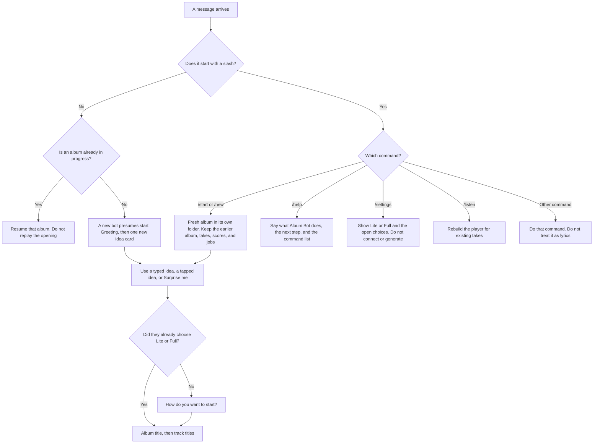
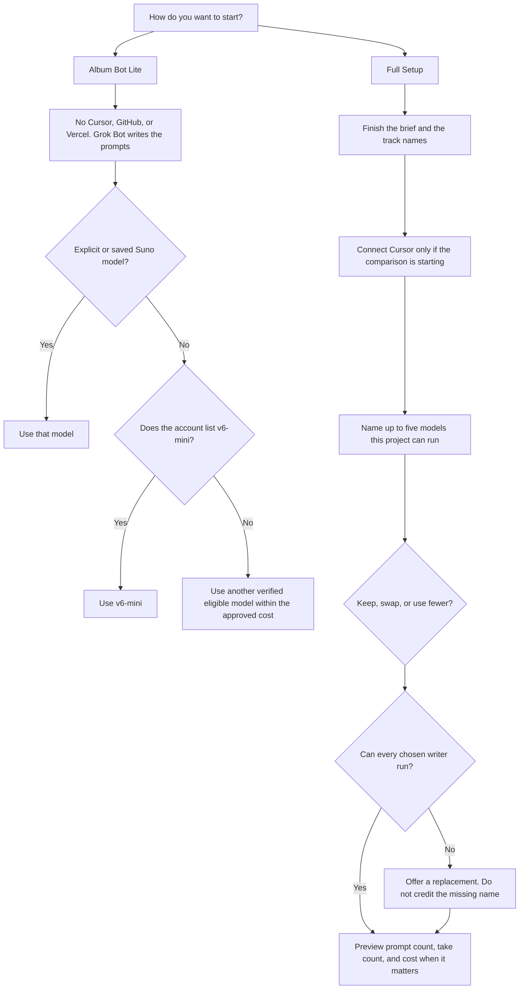
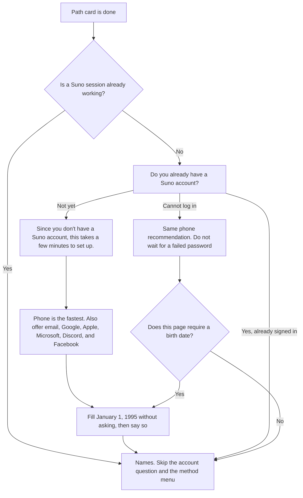
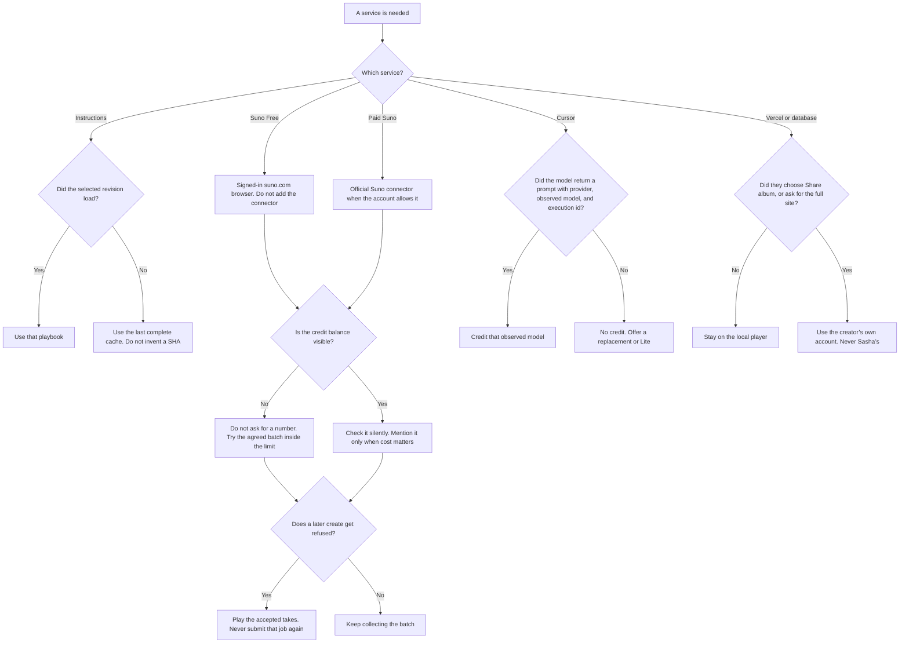
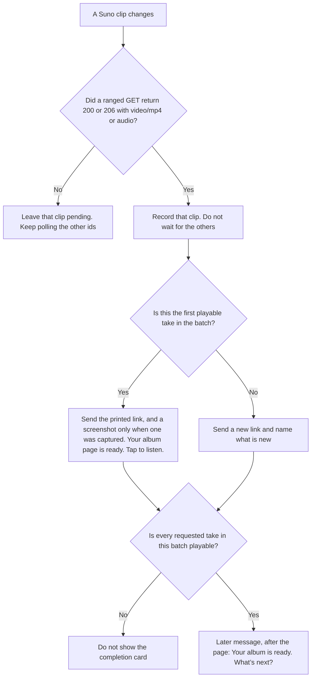
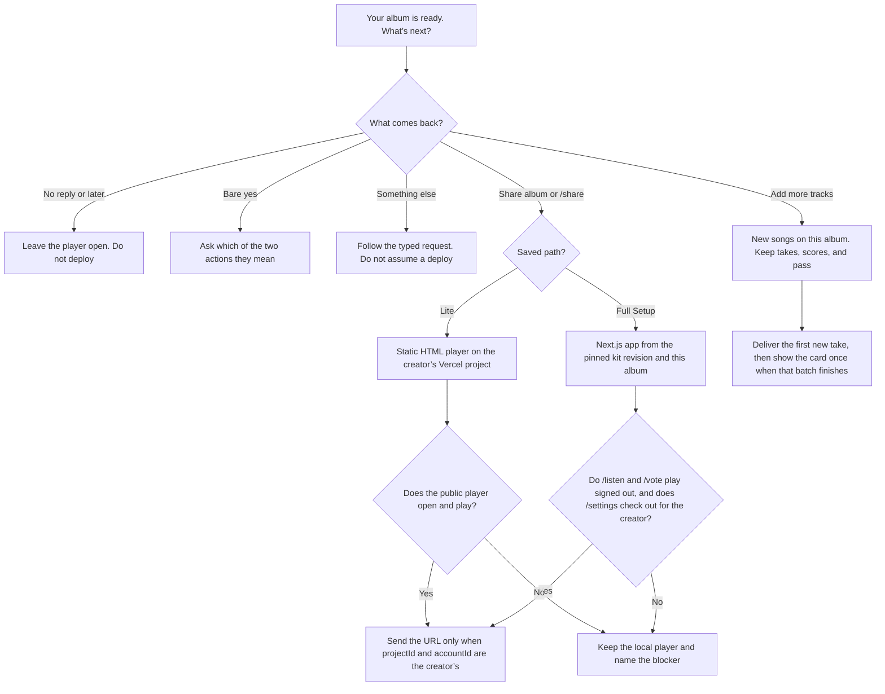
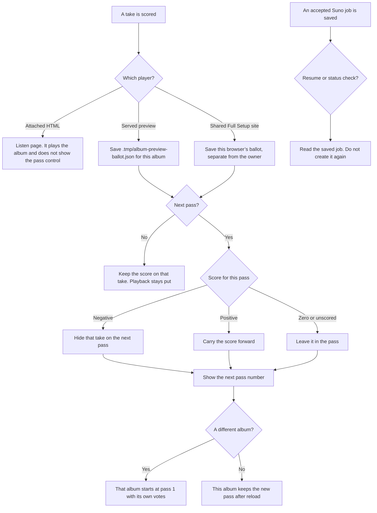

# Album Bot decision charts

These charts match the [product requirements](prd.md). The [execution plan](execution-plan.md) is the demonstration order. The [tester walkthrough](tester-walkthrough.md) is how to check them. There was no earlier chart file in the kit. The November 17 drafts used tables with retired copy. Those choices are redrawn here.

## New bot, returning bot, and /start

Help and settings are available before a path is chosen. Neither one starts Suno.

## Lite or Full Setup

The Full Setup card copy is the five-model sentence. It does not offer a website or a 5–10 minute estimate. That time is said later, and only if a sign-in is required.

## Suno account

A working session skips the question and the method menu. The greeting and the path card do not ask this. If they do not have an account, say “Since you don't have a Suno account, this takes a few minutes to set up.” Recommend phone: “Phone is the fastest. Suno texts you a code and you're in.” Fill January 1, 1995 without asking, then say “I just picked Jan 1, 1995 for the birthday so sign-up keeps moving; you can change it later in Suno settings.” Names and the brief continue while the code is entered. A Create waits until the session can create.

## Connections and fallback

## First playable take, then the finished batch

The first playable song may be any track in the batch. A streaming public CDN URL is the gate. Aim to update the same page within ten seconds of that URL, while the other clip ids keep polling in the background. The exporter is already on disk before the first Create. The first line is “Your album page is ready. Tap to listen ↓”, with “Cool, the first ones are in. Spinning up your album page now. Tap here to listen.” When other tracks on the list do not have a take yet, the line includes “I’ll make the next tracks on the album. /more makes more takes of this song, and /pick chooses favorites.” Start those tracks without waiting. /more and /pick are secondary and do not append songs. If the command prints `preview`, attach that screenshot of the real page. If it does not, send the file with no picture. The completion card waits until every requested take is playable, and until a later message after the page. Generation starts with “The first take usually starts playing in about 20–30 seconds.”

## Share album, Add more tracks, or a custom reply

`/more` makes more takes of a track that already exists. It is not Add more tracks.

## Voting passes and recovery

